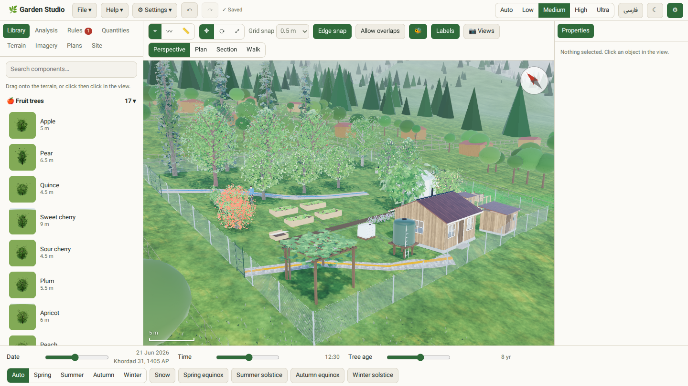
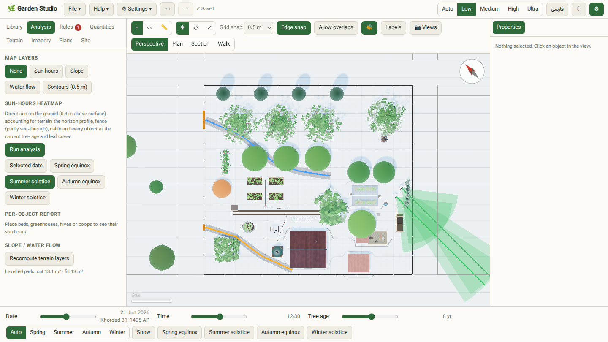
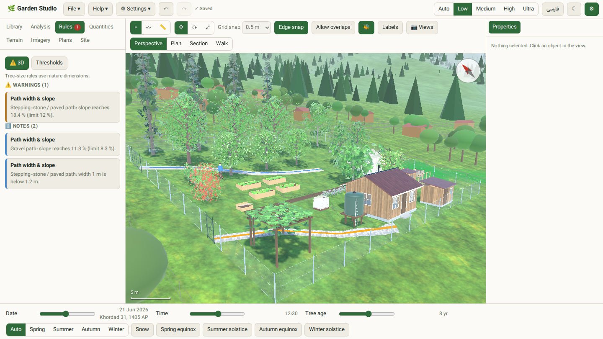
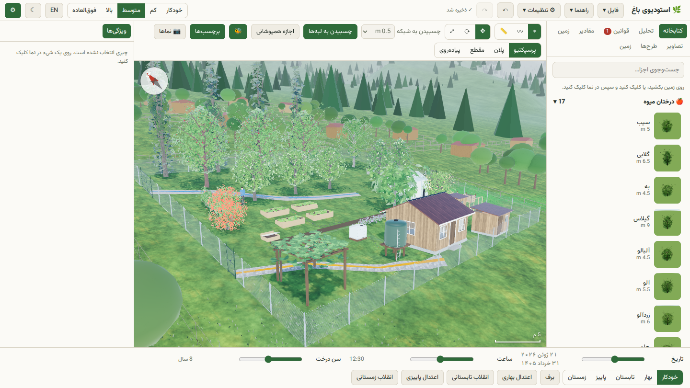

# 🌿 Garden Studio (Bagh)

**An offline-first, in-browser 3D garden planner for a real sloped plot.**
Lay out fruit trees, beds, a cabin, water tanks, hives and paths on true terrain, then see how the sun, slope and water behave through the seasons and as the trees grow. English and Persian (RTL) are both supported.



## Why

Planning an orchard on a hillside is hard to do on paper. The ground slopes, trees shade each other, paths get too steep, and a tree that is 1 m tall today will be 6 m wide in ten years. Garden Studio models the terrain and the plants together, so you can try layouts and check them before planting.

The default site is one real plot: **33 × 30 m, 10° slope falling south, Alborz foothills**. Every value is editable in the Site Setup panel.

## Features

- **True 3D terrain.** A single `heightAt(x, z)` height function drives everything, with sculpt tools, terraces and levelled pads (cut/fill volumes are reported).
- **Component library.** Data-driven catalog of fruit trees, shrubs, raised beds, a greenhouse, Langstroth hive, chicken coop, tanks, compost bins, paths, pipes and more, all procedurally modelled with no asset downloads.
- **Direct editing.** Drag from the library onto the terrain, then move, rotate and scale. Includes grid and edge snapping, numeric fields, undo/redo, copy/paste, array tool, collisions and a measure tool.
- **Time controls.** Date, time of day and *tree age* sliders with season presets, solstices/equinoxes, snow, and a Jalali (Persian) calendar readout.
- **Analysis.**
  - Sun-hours heatmap (terrain, horizon, fence, cabin and plants at the chosen leaf cover), computed in a Web Worker
  - Slope, water-flow and contour overlays
  - Per-object sun report
- **Rules engine.** Flags things like path slope and width, and tree spacing at mature size, with editable thresholds.
- **Quantities.** Bill of materials for what you've placed.
- **Scenarios.** Keep several plans, compare them, and save bookmarked camera views.
- **Reference imagery.** Overlay a photo or map and calibrate it with two points.
- **Views.** Perspective, plan, section and first-person walk.
- **Context layer.** Neighbouring buildings and surrounding forest for realistic shading and horizon.
- **Exports.** PNG, PDF, GLB (3D model), CSV, JSON project, and video.
- **Offline PWA.** Installable, autosaves locally (IndexedDB), no network needed at runtime.
- **i18n.** English and Persian with full RTL layout, with an option for Persian digits.

## Screenshots

| Plan view with analysis panel | Rules engine |
| :---: | :---: |
|  |  |

| Persian / RTL interface |
| :---: |
|  |

*Screenshots show the built-in example plan (File → Load example) at 8-year tree age, medium render quality.*

## Getting started

Requires Node.js 20+.

```bash
git clone https://github.com/mohammadmaso/bagh.git
cd bagh
npm install
npm run dev
```

Open the printed URL, then use **File → Load example** to load a populated plan.

### Scripts

| Command | What it does |
| --- | --- |
| `npm run dev` | Start the Vite dev server |
| `npm run build` | Type-check and build for production (output in `dist/`) |
| `npm run preview` | Serve the production build |
| `npm test` | Unit tests (Vitest) |
| `npm run e2e` | End-to-end tests (Playwright) |
| `npm run typecheck` | TypeScript check only |

Render quality can be forced with a URL parameter, e.g. `/?q=low`, `q=medium`, `q=high` or `q=ultra`. Auto mode adapts to your GPU.

## Tech stack

TypeScript · React 19 · [three.js](https://threejs.org/) (with postprocessing, three-mesh-bvh) · Zustand + Immer (undo/redo via patches) · [SunCalc](https://github.com/mourner/suncalc) · jsPDF · Vite · Vitest · Playwright.

## Project layout

```
src/core      pure functions: terrain, sun, rules, quantities, geometry (unit-tested)
src/data      all tunables: site defaults, catalog, rules, plants, example plan
src/render    three.js engine, layers, procedural models
src/store     Zustand store, undo/redo
src/ui        React panels and toolbars
src/i18n      English / Persian strings
tests, e2e    Vitest unit tests and Playwright specs
docs          assumptions and design decisions
```

Coordinates: X east, Z south, Y up, origin at the NW corner of the plot.

More detail: [PLAN.md](PLAN.md), [docs/ASSUMPTIONS.md](docs/ASSUMPTIONS.md), [docs/DECISIONS.md](docs/DECISIONS.md).

## Caveats

Plant data are approximate defaults for 400–800 m Alborz north-slope conditions and are flagged "approximate – verify" in the UI. The surrounding landscape is procedural, not real elevation data. See the assumptions doc for the full list.

## License

[MIT](LICENSE)
